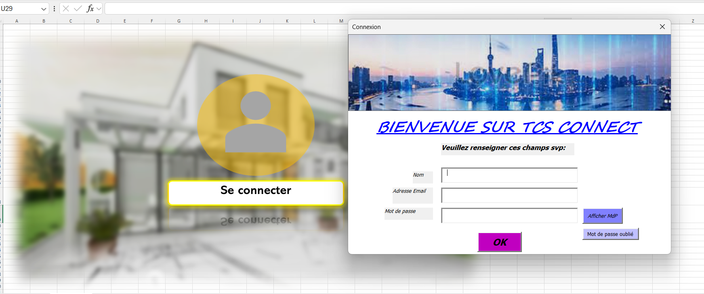
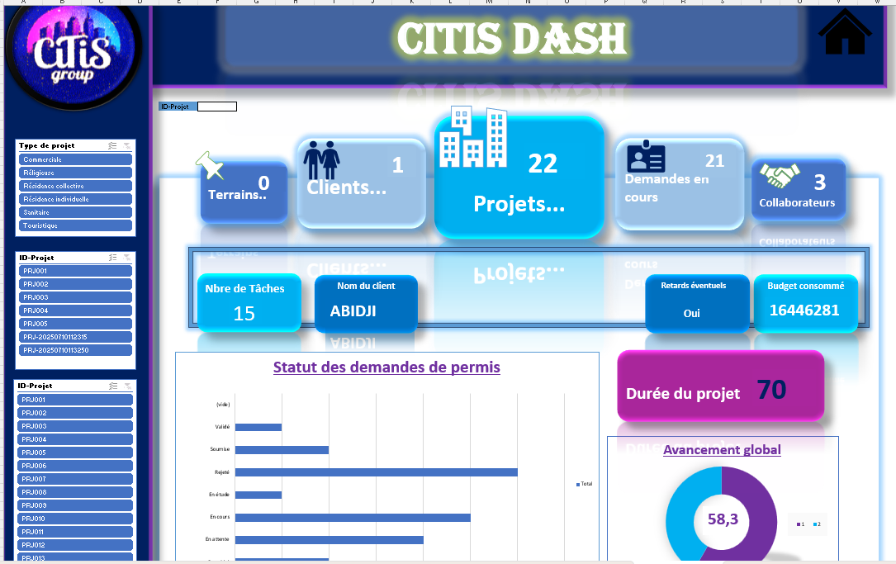

# gestion-projets-immobiliers-vba

# Gestion de projets immobiliers : application Excel/VBA

Projet de première année, ENSEA (2024-2025). Statut : **version 1**.

## Objectif
Centraliser le suivi de projets de construction immobilière dans un fichier Excel automatisé
avec VBA : clients, terrains, budget, permis, avancement des chantiers et tableau de bord.

## Contenu de la version 1

| Module | Inclus dans la version 1 |
|---|---|
| Accueil (menu principal) | oui |
| Clients | oui |
| Terrains |oui  |
| Budget |oui  |
| Permis de construire | oui |
| Projets | oui |
| Gros œuvre | oui |
| Second œuvre | oui |
| Finitions | oui |
| Synthèse (tableau de bord) | oui |
| Synchronisation cloud | Non |
|notifications par e-mail| Non |

## Captures

## Utilisation
1. Ouvrir `application/[Version1].xlsm`.
2. Activer les macros lorsqu'Excel le propose.
3. Naviguer depuis l'écran d'accueil : [Après connexion explorer les fonctionnalités de l'application en cliquant sur les boutons].

## Organisation du dépôt
- `code/` : les modules VBA exportés (lisibles directement sur GitHub)
- `images/` : captures d'écran

## Suite prévue
- Fonctions collaboratives

## Mon rôle
Projet de groupe de trois étudiants ; j'ai réalisé l'essentiel du développement VBA et du design de l'application.

## English summary
Excel/VBA application to manage real-estate construction projects (clients, land, budget,
permits, site progress, dashboard). Version 1 includes the modules listed above. Team of
three; I developed most of the VBA code and the application design.
